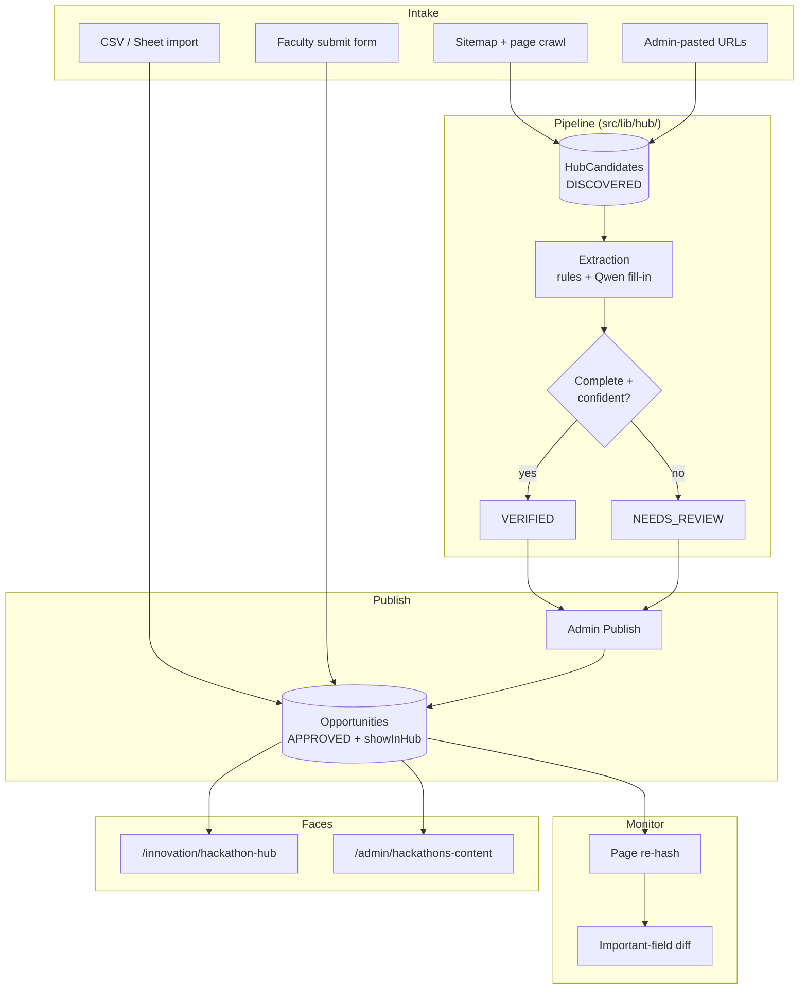
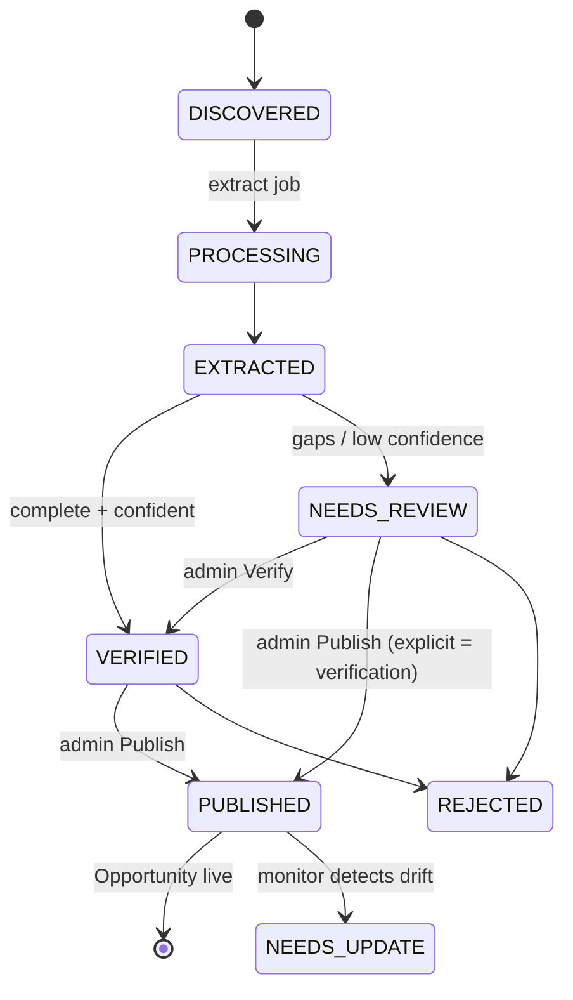

# Hackathon Hub

External hackathon discovery, verification, publishing, and student-facing browsing for the TCET CoE Portal. One-line idea: **a 10-column student viewer backed by a 40-field automated data pipeline** — discover → extract → validate → deduplicate → verify → publish → monitor → update.

## Contents

1. [Overview](#1-overview)
2. [Architecture](#2-architecture)
3. [Data model](#3-data-model)
4. [Pipeline stages](#4-pipeline-stages)
5. [Student interface](#5-student-interface)
6. [Admin interface](#6-admin-interface)
7. [CSV / Google Sheet import](#7-csv--google-sheet-import)
8. [API reference](#8-api-reference)
9. [Automation and scheduling](#9-automation-and-scheduling)
10. [Verification, confidence, and data-quality rules](#10-verification-confidence-and-data-quality-rules)
11. [Deployment checklist](#11-deployment-checklist)
12. [Troubleshooting](#12-troubleshooting)
13. [File index](#13-file-index)

---

## 1. Overview

Students previously had no single place to find outside hackathons, and faculty re-typed event details from one platform to another. The Hub fixes both sides:

- **Students** browse verified hackathons at `/innovation/hackathon-hub` with search, grouped filters, auto-calculated statuses, distance from TCET, detail views, and bookmarks.
- **Admins** curate from `/admin/hackathons-content`: a review queue fed by automated discovery, one-click Verify/Publish, CSV/Sheet bulk import, and source toggles. Target workflow: open queue → review → publish → exit.
- **Automation** (`/api/cron/hub`, triggered manually) crawls sources, extracts structured data, and re-checks published pages for changes. The Hub sends no email.

Design decision worth knowing: the Hub **reuses the `Opportunity` system** instead of a parallel table. Every Hub card is an `Opportunity` row; the Hub is its hackathon subset, gated by `showInHub`. This reuses moderation, bookmarks, validators, and admin UI instead of duplicating them. New tables (`HubSource`, `HubCandidate`, `HubImportLog`) hold only pipeline state.

---

## 2. Architecture

Tech mapping of the original PHP-oriented proposal onto this stack: PHP cron files → one guarded Next.js cron route with `?job=` stages; Google Sheets API → CSV text or Sheet CSV-export URL (no OAuth needed); `hackathons` table → extended `Opportunity` model; PHP REST → Next.js route handlers.

---

## 3. Data model

### 3.1 `Opportunity` (extended)

Existing catalog row. Hub-relevant additions (all nullable/additive, zero-backfill migrations):

| Field | Type | Meaning |
|---|---|---|
| `mode` | `ONLINE \| OFFLINE \| HYBRID \| null` | Event format |
| `venue`, `city`, `state` | `String?` | Where |
| `startDate`, `endDate` | `DateTime?` | When |
| `teamMin`, `teamMax` | `Int?` (1–20) | Team size range |
| `sourceUrl` | `Text?` | Page the data came from |
| `sourceType` | `String` (default `ADMIN`) | `OFFICIAL_WEBSITE`, `DEVFOLIO`, `UNSTOP`, `HACKEREARTH`, `HACK2SKILL`, `MLH`, `INDIAHACKATHONS`, `COLLEGE_WEBSITE`, `GOVERNMENT`, `SOCIAL_MEDIA`, `ADMIN`, `GOOGLE_SHEET`, `OTHER` |
| `verificationStatus` | `String` (default `UNVERIFIED`) | `UNVERIFIED`, `PLATFORM_VERIFIED`, `OFFICIAL_SOURCE`, `ADMIN_VERIFIED`, `VERIFIED`, `NEEDS_UPDATE` |
| `lastVerifiedAt` | `DateTime?` | Last human/machine check |
| `pageHash` | `String?` | SHA-256 of normalized source page (change detection) |
| `showInHub` | `Boolean` (default `false`) | **Subset boundary** — only `APPROVED + showInHub` rows appear in the Hub |

Indexes: `status`, `category`, `registrationDeadline`, `mode`, `city`, `verificationStatus`, `startDate`, `showInHub`.

### 3.2 `HubSource` — source registry

One row per discovery source; jobs never hard-code sources. Fields: `key` (unique), `label`, `method` (`PAGE`/`RSS`/`API`/`MANUAL`), `frequency` (`DAILY`/`WEEKLY`), `priority` (higher wins conflicts), `enabled`, `lastRunAt`, `lastError`. Defaults are seeded by `ensureHubSources()` (11 sources; JS app-shell crawlers sit at `MANUAL` so they accept pasted URLs without wasting fetches).

### 3.3 `HubCandidate` — candidate store

A discovered URL before it becomes public. `status` lifecycle:

Fields: `url` (unique), `source`, `sourceType`, `title`, `extracted` (JSON), `confidence` (float), `pageHash`, `error`, `opportunityId` (set on publish).

### 3.4 `HubImportLog`

Append-only run log: `source` (`CSV`/`SHEET_URL`/`DISCOVERY`), `discovered`, `inserted`, `updated`, `rejected`, `published`, `errors` (first 50).

---

## 4. Pipeline stages

All in `src/lib/hub/`, triggered by `/api/cron/hub?job=` (see §9).

### 4.1 Discovery (`discovery.ts`)

1. **Sitemap-first** (`discoverFromSitemap`): one fetch of `indiahackathons.com/sitemap.xml` yields every `/events/` URL (complete coverage, no HTML parsing).
2. **Page crawl** for enabled `PAGE` sources: polite fetch (15s timeout, 1.5s gap, `TCET-CoE-HubBot/1.0` user-agent), extract links whose titles match hackathon keywords, skip nav noise, listing-page titles ("Explore hackathons", count-style and platform-index titles), self-links, and form paths (`/submit`, `/login`…).
3. **Dedupe** by exact URL; each new candidate stores the source page's SHA-256 as its baseline `pageHash`; per-source errors recorded on the source row, never aborting other sources.

4. **Render fallback** (`firecrawl.ts` -> `fetchHtmlWithRender`): when a plain fetch returns a JS shell (under 900 visible chars), the page is re-fetched through the self-hosted renderer and the post-JS HTML is used. Both discovery and extraction route through this one helper, so JS-heavy sources are fixed in one place. Measured: Unstop's listing 442 -> 5,906 visible chars; HackerEarth 496 -> 7,314.
5. **Search stage** (`discoverFromSearch`): for platforms whose listings stay unusable, open-internet search supplies event URLs, filtered by the source's own `isEventUrl` matcher so index pages ("Competitions", `/hackathons/applied`) never become candidates. The same matcher is applied to crawled links, so both paths reject the same junk.

Both stages are **optional and self-healing**: with no renderer configured the pipeline behaves exactly as before (`unstop`/`hackerearth`/`devfolio` stay `MANUAL`), and re-enabling it flips them to `PAGE` on the next `ensureHubSources()` run.

### 4.1a Search query strategy (§10) and geo tiers (§11)

Implemented as `SEARCH_SOURCES` in `discovery.ts`; runs only when a self-hosted search provider is configured (`FIRECRAWL_URL`). Listed here as the strategy each entry encodes.

- **Location:** hackathon Mumbai / Navi Mumbai / Thane / Pune / Maharashtra / India 2026, online hackathon 2026
- **Institution:** college / engineering-college-Maharashtra / university hackathon Mumbai 2026
- **Technology:** AI, ML, GenAI, cybersecurity, cloud, IoT, blockchain hackathon 2026 India
- **Platform:** `site:devfolio.co`, `site:unstop.com`, `site:hackerearth.com`, `site:hack2skill.com`, `site:mlh.io` scoped queries
- **Tiers:** local (TCET vicinity, Mumbai, Navi Mumbai, Thane) → Maharashtra (Pune, Nagpur, Nashik, Chhatrapati Sambhajinagar, Kolhapur) → national (India-wide, online, international-online open to Indian students)

### 4.2 Extraction (`extract.ts`)

Three layers, in order — missing stays `NULL`, never invented:

1. **JSON-LD first**: `extractJsonLdEvent()` parses schema.org `Event` blocks (name, dates, organizer, city/state, attendance mode → `ONLINE`/`OFFLINE`/`HYBRID`, offer URL). Proven on indiahackathons event pages.
2. **Rule heuristics**: `<title>`/og:title/h1, "organized by" patterns, date regexes (event-start phrasing preferred over publish dates), city near location keywords (Online events get no city — footer noise), prize only with a real amount, team ranges (inverted ranges nulled), eligibility only with a structured label.
3. **Qwen fill-in** (`aiFill`): when `QWEN_API_KEY` + `AI_GATEWAY_URL` + `AI_GATEWAY_MODEL` are set, the model receives page text and fills *only* the still-missing mandatory fields. Without config the pipeline is rules-only (warns once per run).

**Never invented** (regression-tested in `hub-checks.ts`):
- `registrationUrl` is either a genuine link (relative links resolved against the page) or `null`. The listing page is never substituted; the candidate keeps `url` as the source. Malformed/`javascript:` links are dropped, not repaired. AI echoes of the page URL are rejected.
- `organiser` comes from JSON-LD or "hosted/presented by …" text only. A crawled hostname (`devfolio.co`) is never treated as the organiser. Matches that run into page chrome ("best viewed in chrome, opera…") are rejected outright — a missing organiser is recoverable, a wrong one is not.
- `endDate` is only set from an explicit value or a genuinely later date found on the page. One date does not imply a one-day event.
- Numeric dates: `13/04/2027` → 13 Apr, `04/13/2027` → 13 Apr, but `03/04/2027` is ambiguous and rejected. Written-month and ISO dates are validated against a real calendar (no `31 February`, leap-aware).
- AI output: JSON `null`/`"null"`/`"undefined"`/`"N/A"`/`"none"`/`"-"`/blank are missing, dates must be valid ISO, and invalid values never overwrite rule/JSON-LD evidence.
- `registrationUrl` is never a LISTING page URL. On a platform that signs users up on the event detail page itself (`registrationOnPage` — Unstop, Devfolio, Hack2Skill), the event page URL **is** the registration URL and is used. Without this, `registrationUrl` is unsatisfiable for those sources and no event from them could ever auto-verify.

**Confidence** (`scoreConfidence`): base 0.4 + 0.05 per mandatory field (six -> 0.70) + source bonus (official/government/admin +0.2, aggregators +0.15) + city 0.03 + prize 0.02, capped 0.95. `HUB_VERIFY_THRESHOLD` (0.9) **and** all mandatory fields → `VERIFIED`, else `NEEDS_REVIEW` listing what's missing.

Both conditions are required: `mandatoryMissing().length === 0 && confidence >= HUB_VERIFY_THRESHOLD`. The score alone reaching 0.9 does not pass — a complete government event still needs every mandatory field.

Ceilings that ACTUALLY reach the threshold (this is the trap — verify it whenever the formula changes):

| source tier | complete extraction + city + prize | can auto-verify |
|---|---|---|
| official / government / admin | 0.95 | yes |
| aggregator (`UNSTOP`, `DEVFOLIO`, `HACKEREARTH`, `HACK2SKILL`, `MLH`, `COLLEGE_WEBSITE`, `INDIAHACKATHONS`) | 0.90 | yes, but only when complete |
| aggregator, ONLINE event (city not applicable) | 0.90 | yes — a city is meaningless for an online event, so its absence must not cap the score |
| aggregator, OFFLINE and no city | 0.87 | no |
| aggregator without city or prize | 0.85 | no |
| unlisted source | 0.75 | no |

`INDIAHACKATHONS` previously appeared in **no** tier, capping it at 0.75 — below the threshold, so its candidates (96 of 111 in a live run) could never verify regardless of extraction quality. Regression-tested in `hub-search-checks.ts`.

**Cities** (`src/lib/hub/cities.ts`) are one registry used by both extraction and distance: name + aliases + coordinates. Adding a city in one place makes it recognisable *and* distance-capable; unknown cities stay `null` (no fabricated "N km").

### 4.3 Publish (`pipeline.ts`)

Admin-only, explicit. Merges by registration/source URL, else normalized name + organizer. Missing fields become `NULL` (plus a visible "auto-published with missing fields" note); text clipped to column limits (`clipDbString`/`fitUrl` — the single DB-boundary guard against MySQL `P2000` errors); sets `APPROVED + ADMIN_VERIFIED + showInHub + pageHash`.

**Curated-record protection** (same policy as CSV import): if the matched record is `VERIFIED`, `ADMIN_VERIFIED`, or `OFFICIAL_SOURCE`, publication does **not** overwrite it — the candidate moves to `NEEDS_UPDATE` with an actionable conflict message and the admin endpoint returns `409`. This applies even to an explicit publish click. For unverified pipeline-owned rows the refresh is null-safe (a thin re-extraction cannot erase fields it failed to find) and a placeholder description never replaces a real one. Dates pass through `toDbDate` (`src/lib/hub/dates.ts`), so an invalid/AI-sentinel date becomes `NULL` instead of an Invalid `Date`.

### 4.4 Monitor (`monitor.ts`)

- **Bounded, rotating execution**: each invocation checks at most `HUB_MONITOR_BATCH` (default 10, max 50) approved events within `HUB_MONITOR_BUDGET_MS` (default 45 s), respecting `HUB_MONITOR_DELAY_MS` (default 400 ms) between fetches. Ordering is `lastVerifiedAt ASC, id ASC` — a durable rotating checkpoint with no extra state. Every completed attempt — including 403/empty and rows with no watch URL — stamps `lastVerifiedAt`, so a permanently restricted or uncheckable row cannot starve the queue. The result reports `checked` / `deferred`; later runs continue where this one stopped. The cron route also refuses to start a monitor while one is in flight.
- **Change detection**: re-fetch each published source page, SHA-256 the normalized content; on drift, re-extract and diff important fields (deadline, prize, eligibility, team, venue, dates) → `NEEDS_UPDATE` for admin review. HTTP 404 → `NEEDS_UPDATE`; 403/empty → attempt recorded. No emails are sent.

---

## 5. Student interface

Route: `/innovation/hackathon-hub` (linked left of Innovation Home as a gold **Hackathon Hub** button).

- **Search** (name/organizer/keyword) on its own full-width line.
- **Grouped filters** with plain labels: Where (city) · How (mode) · Status (registration) · When (month) · What (domain/tech) · Order (newest/deadline) · footer count + **Clear all**. (The old quick-chip row was removed as redundant.)
- **Cards** (8 fields): status badge, event badge, verification badge, title, organizer, date, location (+ mode + `X km from TCET`), team, domain, prize, deadline. Register / View Details / Bookmark.
- **Honest unknown handling**: the DB keeps `NULL`, but cards never show a confusing `UNKNOWN` badge — status falls back to the start date and is marked `*` ("deadline not published, derived from start date", tooltip + footer legend); deadline line reads "Not published — starts …".
- **Details modal**: Overview, Registration, Eligibility, Competition, Benefits, Verification (last-verified + source link).

---

## 6. Admin interface

Route: `/admin/hackathons-content` — reachable via Navbar → Portals → **Hackathons Content** (admin-only), a shortcut card on the Admin Panel → Content tab, and back-links in its own header. Sections:

1. **Hub Dashboard** — Total / Active / Closing Soon / Needs Review / Expired / New This Week + **Run pipeline now** (runs `?job=all` with your session; result summary inline). There is no automated schedule.
2. **Hub Review Queue** — status filter (default **Actionable** = needs-review + verified + needs-update; verified rows stay until published), per-row Verify / Publish / Reject, confidence + missing-field notes inline.
3. **Hub Import — Sheet/CSV** — CSV textarea or Sheet CSV-export URL; result counts + first error.
4. **Hub Sources** — enable/disable toggles, method/frequency/priority display, per-source `lastError`.
5. Existing **External Opportunities moderation** (approve/reject/delete) now with an **In Hub ✓ / Hub?** toggle + badge per row.

---

## 7. CSV / Google Sheet import

No Google OAuth needed: maintain a Sheet, use File → Share → **Publish to web (CSV)**, paste the export URL — or paste CSV text directly. One row = one hackathon; the parser handles quoted commas and newlines.

**Compulsory per row:** `title` (≥2 chars), `organizer` (≥2 — accepts `organizer`, `organiser`, or `owner` headers). `category` defaults to `Hackathon`.

**Optional (blank → NULL):** `description`, `eligibility`, `prize`, `applicationUrl`, `registrationDeadline`, `themes`/`domains`, `technologies`, `mode` (`ONLINE`/`OFFLINE`/`HYBRID`), `venue`, `city`, `state`, `startDate`, `endDate`, `teamMin`/`teamMax` (1–20), `sourceUrl`, `sourceType`. Header names are forgiving (`eventName`/`title`/`name`, `organiser`, `deadline`, `registrationUrl`/`applyLink`, `officialUrl`, `prizePool`, `domains`, `eventType`… — full map in `src/lib/hub/csv.ts`).

**Semantics:** admin imports publish immediately (`APPROVED + ADMIN_VERIFIED + showInHub`); faculty imports land `PENDING`. Dedupe by source URL, then normalized name + organizer. **Dates must be real ISO dates** (`YYYY-MM-DD`, or an ISO timestamp); `N/A`, `-`, `null`, impossible calendar dates and ambiguous numeric forms are rejected per row with an actionable error — they can never reach Prisma as an Invalid `Date`. **Conflict guard (shared with pipeline publication):** rows colliding with `VERIFIED`/`ADMIN_VERIFIED`/`OFFICIAL_SOURCE` records are rejected and counted in `conflicts`, never overwritten. Updates to unverified rows are null-safe (blank cells do not erase existing values) and a blank/placeholder description never replaces a real one. Every run writes a `HubImportLog`.

---

## 8. API reference

Public:

| Endpoint | Purpose |
|---|---|
| `GET /api/hackathon-hub?search=&city=&mode=&domain=&month=YYYY-MM&regStatus=&eventStatus=&sort=&limit=&cursor=` | Student listing (`APPROVED + showInHub`), derived `regStatus`/`eventStatus`, `regStatusSource`, `distanceKm`/`distanceLabel`, `myInterest`. Response: `{ items, nextCursor, hasMore }` |

Public listing behaviour:

- **Filter before limit.** `city`, `mode`, `month` (UTC range on `startDate`) and `search` are DB predicates. `domain` (themes/technologies) and the derived `regStatus`/`eventStatus` are applied while scanning the ordered result set — Prisma's MySQL JSON filters cannot match inside an array (verified empirically), so the endpoint keeps scanning 100-row pages until the requested page is full (hard cap 2000 rows/invocation). No filter is ever applied after truncation.
- **Cursor pagination.** `limit` 1–50 (default 24); `cursor` is the last item id from the previous page. Ordering is `createdAt DESC, id DESC` (newest) or `registrationDeadline ASC, id ASC` (deadline), so pages are deterministic. Invalid cursors → `400`; stale cursors (row deleted) → `400`.
- **Rate limit.** 60 requests/minute per client key (`x-forwarded-for`/`x-real-ip`; the header is caller-controlled, so this is best-effort), `429` beyond that. Process-local, which matches the single-pm2-process deployment; the Map is hard-bounded at 10,000 keys with oldest-first eviction, so fresh spoofed keys cannot grow it without bound. Move to shared storage if the app is horizontally scaled.
- **Allowlist.** The select omits `createdById` and `pageHash`. `verificationStatus`/`sourceUrl`/`lastVerifiedAt` remain for the trust badge and source link.

Admin (all `ADMIN`, 401/403 otherwise):

| Endpoint | Purpose |
|---|---|
| `GET /api/admin/hub/stats` | Dashboard rollup |
| `GET /api/admin/hub/candidates?status=a,b` | Review queue (comma list; omit = all) |
| `POST /api/admin/hub/candidates` `{url, source?, sourceType?, title?}` | Track a URL manually |
| `PATCH /api/admin/hub/candidates/[id]` `{action: verify\|reject\|publish}` | Verify / reject / publish-and-promote (`409` on curated-record conflict) |
| `POST /api/admin/hub/import` `{csvText? , sheetUrl?}` | Bulk import |
| `GET /api/admin/hub/import` | Recent import logs |
| `GET /api/admin/hub/sources` · `PATCH … {key, enabled?, priority?}` | Registry management |
| `PATCH /api/admin/opportunities/[id]` (+`showInHub`) | Edit / toggle Hub visibility |

Automation (`CRON_SECRET` header/query **or** admin session):

| Endpoint | Purpose |
|---|---|
| `GET /api/cron/hub?job=discover\|extract\|monitor\|all` | Bounded pipeline slice (10-min extraction/discovery and 1-h monitor repeat guards; monitor refuses to overlap) |

Note: a `200` means **this bounded slice completed**, not that the whole catalogue was processed. Monitor results include `checked` and `deferred`; the next run continues the rotation.

---

## 9. Automation and scheduling

- **Code:** stages live in `src/lib/hub/`; the only entrypoint is `/api/cron/hub` (`src/app/api/cron/hub/route.ts`), following the repo's cron conventions (see `docs/handoff/CRON_JOBS.md`).
- **Scheduling:** none. The GitHub Actions workflow was removed; run `?job=all` from the dashboard (admin session) or call the route manually.
- **Bounded work:** discovery walks a fixed source list, extraction takes 10 candidates, and monitoring takes a small batch inside a time budget. No stage runs unbounded inside one HTTP request.
- **Manual:** the dashboard's **Run pipeline now** button (admin session, no secret needed).

---

## 10. Verification, confidence, and data-quality rules

- **No guessing:** missing is `NULL` in the DB; derived display values are labeled (`*`, tooltips, "Not published").
- **No fabricated data:** registration URLs, organisers, and end dates are never inferred from the page URL, hostname, or a single date. Ambiguous numeric dates are dropped.
- **Date safety:** every AI/CSV/publish path validates dates at the persistence boundary (`toDbDate`); invalid values become `NULL`, never an Invalid `Date`.
- **Every published event has a source URL** (candidate URL carried through publish).
- **Important-field changes require review** (`NEEDS_UPDATE`, never silent).
- **Broken links trigger review** (404 → `NEEDS_UPDATE`).
- **Curated data wins:** `VERIFIED`/`ADMIN_VERIFIED`/`OFFICIAL_SOURCE` rows are never overwritten by pipeline publication or CSV import; conflicts are flagged (`409` / `conflicts` stat) for a human merge.
- **Duplicates merge** (URL first, normalized name + organizer second; exact-match only — yearly editions never auto-fuse).
- **Publish is always explicit** (admin click or admin import); the pipeline never auto-publishes.
- **Column safety:** all writers clip to `VARCHAR(191)` (`clipDbString`/`fitUrl`); forms validate the same limits for clear 400s instead of `P2000` 500s.

---

## 11. Deployment checklist

- [ ] Merge the Hub branch; deploy auto-runs `migrate deploy` — migrations are additive/nullable (`showInHub` backfills already-approved hackathon-like rows visible).
- [ ] Env: optional `CRON_SECRET` if triggering the route outside an admin session, optional `QWEN_API_KEY` (rules-only extraction without it).
- [ ] Seed content: publish the review queue + import a starter CSV so the Hub isn't empty.
- [ ] Spot-check as student: only `APPROVED + showInHub` rows visible; admin-only routes 403 otherwise.
- [ ] Before merging: `npx tsc --noEmit`, `npm run lint` (repo has pre-existing `no-explicit-any` errors in `email-delivery.ts`/`mailer.ts`), `npm run build`, and `npx --yes tsx --env-file=.env scripts/checks/hub-checks.ts` (67 checks; DB-backed ones create and delete uniquely-marked rows).

**Known limits (by design, §42):** JS-rendered platform crawlers are parked at `MANUAL` (page fetches return app shells); auto-discovery's reliable legs are the indiahackathons sitemap + pasted URLs + CSV. Prize pools and registration deadlines are rarely published anywhere — rows surface in `NEEDS_REVIEW` missing only the deadline. No search-API provider, personalization, maps, or chatbot.

---

### Optional: self-hosted renderer and search

| Var | Default | Meaning |
|---|---|---|
| `FIRECRAWL_URL` | unset (disabled) | Self-hosted Firecrawl endpoint. **Loopback or RFC1918 only** — a public host is refused at startup so the app can never become an open egress proxy. |
| `FIRECRAWL_API_KEY` | unset | Sent as a bearer token if the local service requires one. |
| `FIRECRAWL_ALLOWED_HOSTS` | unset | Comma-separated extra hosts allowed to serve `FIRECRAWL_URL`. Loopback and RFC1918 are always allowed; a LAN/CGNAT address (e.g. `175.175.1.89`, Tailscale `100.64/10`) must be named explicitly. |
| `HUB_RENDER_BUDGET_MS` | `60000` | Rendering time allowed per rolling 10-minute window. Once spent, pages fall back to a plain fetch instead of stalling the request. |
| `HUB_RENDER_MAX_PAGES` | `10` | Renders allowed per rolling 10-minute window. |

### Operating the renderer

- **Bind it to loopback + Tailscale, never `0.0.0.0`.** It is an *unauthenticated* scraping service: bound to `0.0.0.0` every host on the campus `/16` can scrape the internet through it. `127.0.0.1` for local work plus the Tailscale address for prod is enough.
- `GET /api/cron/hub?job=all` now returns `renderer: { configured, healthy, budget }`. A dead renderer otherwise degrades into "fewer candidates" that reads like a normal run.
- **Search is best-effort.** The self-hosted SearXNG gets CAPTCHA-ed and rate-limited by public engines, after which `/v1/search` returns zero rows. Discovery is designed not to depend on it: the crawl+render path still finds Unstop/Devfolio/HackerEarth events (measured 124 candidates with search fully down). Keep several engines enabled in `searxng/settings.yml` so one being blocked does not empty the stage, and treat a `search returned nothing` error in the cron output as an upstream symptom, not a bug here.

With it set: JS-shell pages are rendered automatically, and `unstop` / `hackerearth` / `devfolio` flip from `MANUAL` to `PAGE`. Without it: unchanged behaviour. No third-party search account or per-query credits are involved either way.

## 12. Troubleshooting

| Symptom | Cause → fix |
|---|---|
| Queue empty but rows exist | Queue filter is status-scoped — set **Show** to Actionable/All. (This exact bug shipped once: the filter was hardcoded to `NEEDS_REVIEW`.) |
| `/api/admin/hub/*` → 404 in dev | New route files not registered — full dev-server restart + hard refresh. |
| Publish fails | Only title is required; other gaps publish as NULL. `DISCOVERED` rows must be extracted first. |
| `P2000 value too long` | Writer bypassing `clipDbString` — all Hub writers clip; check custom callers. |
| Cron 403 | Wrong/missing secret (header `x-cron-secret` or `?secret=`); admin session also works on `/api/cron/hub`. |
| Build fails in `.next/dev/types/*.d.ts` with truncated code | Corrupt typegen artifact, not our code — delete `.next/dev/types` and rebuild. |
| Prisma `EPERM` on generate (Windows) | A running `next dev` holds the engine DLL — types still update; regenerate after stopping dev. |
| Stale admin clicks, no console errors | Stale mixed build (AGENTS.md Gotcha #4): kill by port PID, relaunch. |

---

## 13. File index

| Area | Files |
|---|---|
| Pipeline lib | `src/lib/hub/sources.ts`, `discovery.ts`, `extract.ts`, `csv.ts`, `pipeline.ts`, `monitor.ts`, `fetch-guard.ts` |
| Shared Hub logic | `src/lib/hub/cities.ts` (single city/coordinate registry), `src/lib/hub/dates.ts` (sentinel/ISO/ambiguous-date validation), `src/lib/hackathon-hub.ts` (statuses, `isHubCategory`, `clipDbString`, `fitUrl`, source/verification enums) |
| Checks | `scripts/checks/hub-checks.ts` (pure regressions + DB integration for all review issues) |
| Student UI | `src/app/innovation/hackathon-hub/page.tsx`, `src/app/api/hackathon-hub/route.ts` |
| Admin UI | `src/app/admin/hackathons-content/page.tsx` (Dashboard, Queue, Import, Sources) |
| Admin APIs | `src/app/api/admin/hub/{import,candidates,candidates/[id],sources,stats}/route.ts`, `src/app/api/admin/opportunities/[id]/route.ts` (+`showInHub`) |
| Cron endpoint | `src/app/api/cron/hub/route.ts` (manual/admin-triggered; no GitHub Action) |
| Schema | `Opportunity` (+12 Hub columns), `HubSource`, `HubCandidate`, `HubImportLog` in `prisma/schema.prisma` |
| Nav | Hub button in `src/app/innovation/page.tsx`; `Hackathons Content` in `src/components/Navbar.tsx` + Admin Content tab |
| Validators | Hub enums, dates, teams, 191-char caps in `src/lib/validators.ts` |
